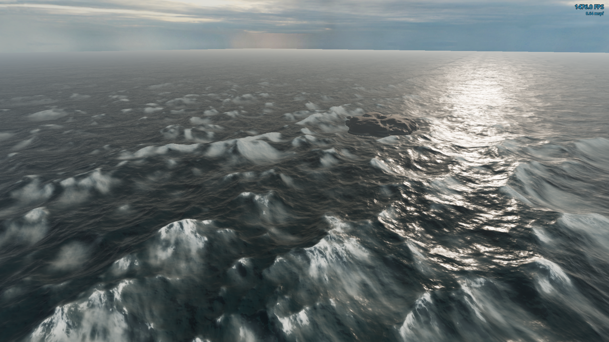

# FFT Ocean for Godot 4.7 (C#)

[](docs/ocean_showcase.mp4)

▶ **[Watch the showcase video](docs/ocean_showcase.mp4)** (the screenshot links to it too)

A drop-in, GPU-simulated ocean for Godot 4.7 .NET (Forward+). Three FFT cascades run in GLSL compute on the main
`RenderingDevice`, a camera-local foam field turns breaking crests into whitecaps that age into soft trails, and a
single spatial shader does the sky-driven, painterly shading. It runs at well over 1000 fps at 1080p on a current
desktop GPU.

## The guide (`OCEAN_GUIDE.md`)

This project was built by an AI coding agent from a single written brief, [`OCEAN_GUIDE.md`](OCEAN_GUIDE.md), and then
refined with feedback. The guide is the brief, kept up to date: every technical choice and value in this repository,
why it was chosen, what was tried and rejected, the engine facts that trip people up (Godot 4.7, D3D12), the
verification steps, and the bugs that were already paid for. Read it if you want to understand why the ocean looks and
performs the way it does, change it without re-learning those lessons, or rebuild it in another engine. Handing it to
an agent in an empty Godot 4.7 C# project is meant to reproduce this repository; the "Findings" section at the top lists
the hard-won lessons with pointers to where each is specified.

The repository has three layers:

| Folder | What it is |
|---|---|
| `ocean/` | **The renderer.** One `Ocean` node, its shaders, sea spray, the sea-floor (shore) input, the config and parameter models. No UI, lights, sky, camera or command line. Copy this folder and you are done. |
| `demo/` | The showcase scene: sky presets, sun, fog, a seeded island terrain (ported from Mushrook, with caustics) that feeds the ocean its sea floor, a boat that rides the swell with a chase camera, a fly camera, the parameter panels, JSON presets. |
| `dev/` | Tooling for development (captures, bursts, benchmark, GPU self-test). Not needed to run anything; see `dev/README.md`. |
| `tests/` | TUnit tests for the pure maths in `ocean/core/`. |

## Drop-in usage

1. Copy `ocean/` into your Godot 4.7 C# project (keep it at `res://ocean/`).
2. Instance `ocean/ocean.tscn` in a scene that has a camera, a `DirectionalLight3D` and a `WorldEnvironment`.

That is all: with no config the ocean uses the calm defaults. The ocean follows the active viewport camera and is lit by
the scene's light and environment; it never searches the tree for anything else.

Optional, from code:

```csharp
var ocean = GetNode<Ocean.Ocean>("Ocean");
ocean.LoadConfig("res://my_ocean.json");      // or set the ConfigPath export in the inspector
var c = ocean.Snapshot();                      // a copy of the live config
c.Cascades[0].WindSpeed = 16;
ocean.Apply(c);                                // regenerates only what changed
ocean.SaveConfig("user://ocean.json");
foreach (var set in ocean.Parameters)          // live knobs for your own UI or tools
    foreach (var p in set.Parameters) GD.Print(p.Id, " = ", p.Value);
```

| API | |
|---|---|
| `ConfigPath` (export) | JSON config loaded in `_Ready` (optional) |
| `Config` | the live `OceanConfig` |
| `Snapshot()` | a copy of the live config |
| `Apply(config)` | replaces the config; regenerates a cascade's spectrum only when its spectrum fields change, rebuilds GPU resources only when the resolution changes |
| `LoadConfig(path)` / `SaveConfig(path)` | `res://`, `user://` or absolute paths |
| `Parameters` | `ParameterSet`s: Ocean, Cascade 0–2, Foam field, Spray, Water sampling, Surface (built from the shader's uniform groups) |
| `ConfigChanged` | raised after every `Apply` |
| `SetSeaFloor(floor)` / `ClearSeaFloor()` / `SeaFloor` | the ground under the water (see [Shores and terrain](#shores-and-terrain)); without one the sea is deep everywhere |
| `AddBody(body)` / `RemoveBody(body)` / `ClearBodies()` / `UpdateBodies()` / `Bodies` / `BodyLayer` | things standing or floating in the water: rocks, posts, pontoons, hulls (see [Bodies in the water](#bodies-in-the-water)) |
| `SampleWater(worldPos)` / `SampleWater(positions, results)` | the water over a world xz: `Height` (world y), `Normal`, `Velocity` of the surface water (see [Sampling the water](#sampling-the-water)) |
| `WaterTime` | the waves' clock: the swell cascade's simulation time (s), restarts with the ocean |
| `SampledSwellWaves` / `SampledChopWaves` | components the CPU sampler sums (256 / 32); also in the panel's "Water sampling" set, with how much of each cascade's energy they capture and the last query's cost |

## Shores and terrain

The ocean works with any terrain without knowing what it is: hand it the ground heights once, as a grid, and it
builds a `SeaFloor` (pure C#, `ocean/core/Shore/`):

- **water depth** per sample (sea level − ground);
- **signed distance to the shoreline** in metres (exact Euclidean distance transform; + in the sea, − on land);
- **open sea vs. enclosed water:** wet samples connected to the grid's border are sea; water cut off from it (a pool
  below sea level inside an island) is a lake.

```csharp
// heights: ground y in world metres, row-major (index = z * width + x), one sample every cellSize metres,
// sample (0, 0) at world xz = origin. Call again whenever the terrain changes.
var floor = Ocean.Core.Shore.SeaFloor.FromHeights(heights, width, depth, cellSize,
    new System.Numerics.Vector2(originX, originZ), seaLevel: ocean.GlobalPosition.Y);
ocean.SetSeaFloor(floor);
```

It is uploaded as one small texture and changes how the water behaves over it, all tunable in the Surface panel's
`shore` group (or the config's `surface` overrides):

| | |
|---|---|
| **Quiet water** | each cascade's waves fade out as the water gets shallow: swell first (`shallow_swell_depth` 16 m), then chop (5 m), then ripples (0.6 m). Over land there are no waves, so water never washes through beaches. Lakes keep `lake_waves` (15 %) of every cascade. The deep-water foam field is calmed with the chop. |
| **Shore foam** | a band `shore_band_width` (4 m) wide along the coast and around every [body](#bodies-in-the-water), in metres from the shoreline (independent of the camera). Anything that is neither terrain nor a registered body still gets the thin depth-buffer contact foam (`shore_foam_distance`). |
| **Surf** | wave fronts travelling down the distance field towards the beach (`surf_spacing` 16 m, `surf_speed` 2.2 m/s), fading in over the inner part of `surf_zone` (30 m). They arrive in broken sets, not rings: each front lights only some stretches of coast (`surf_gaps` 0.35, stretches of ~`surf_patch` 40 m), different ones from front to front, every few fronts a stronger one, and coasts turned away from the swell keep less (`surf_windward` 0.6; the lee of a body none). Strength `surf_strength` (1.0). They run through the foam lace like any other foam. |
| **Swash** | when a front reaches the waterline the water runs up the beach and drains back until the next one: the surface within `swash_width` (6 m) of the waterline lifts by up to `swash_height` (0.3 m), so the wet edge climbs a gentle beach by metres and a steep one by less, with fresh foam in the uprush (`swash_foam`). Only where the water at the waterline is shallow: beaches and grounded bodies (a rock's foot), not hulls or sheer walls. The CPU water sampler leaves it out. |
| **Breaking** | foam where the water is shallower than `breaking_ratio` (1.3) × the local wave height: sandbars, reefs and submerged bodies break before the beach. |
| **Colour** | a turquoise lagoon tint over shallow ground (`lagoon_color`, `lagoon_depth` 6 m) and stirred-up sand in the surf zone (`sediment_color`). |

Outside the sea floor's rectangle, and with no sea floor at all, all of this is off and the ocean looks exactly as it
did. The demo's island pushes its heightmap on every (re)generation (`DemoRoot`). The swell direction (for windward
surf and lee) is the way cascade 0's waves travel: against its `windDirection` vector, since the spectrum puts its
energy at wave vectors along the wind and each component is `cos(k·p + ωt)`.

## Bodies in the water

Rocks, posts, pontoons and hulls register a footprint with the ocean, and every water effect reads that one list.
Stationary bodies fold into the shore data the same way islands do, so a sea stack gets the islands' waterline foam,
calm lee, small breaks on its sloping foot and swash; a post gets a small foam collar; a moored hull a waterline and a
lee while the waves keep running under it.

```csharp
using Ocean.Core.Bodies;

// A sea stack 14 m across, 15 m tall, rock debris sloping out 6 m around its foot.
var rock = WaterBody.Circle(new System.Numerics.Vector2(120, -345), radius: 7f, top: 15f);
rock.Skirt = 6f;
ocean.AddBody(rock);
ocean.AddBody(WaterBody.Circle(postXz, 0.15f, top: 2f));                                   // a pile
ocean.AddBody(WaterBody.Box(pontoonXz, headingRad, length: 12f, beam: 2.4f, top: 0.4f));   // a pier block
var hull = WaterBody.Hull(boatXz, headingRad, length: 30f, beam: 11f, draft: 2.5f);         // capsule, waves run under
ocean.AddBody(hull);

hull.Position = newXz;      // bodies are plain objects: change them, then
ocean.UpdateBodies();       // refold (next frame, only if a stationary body really changed)
hull.Stationary = false;    // under way: left out of the shore data, still in the list (velocity for later effects)
```

A `WaterBody` is a rounded rectangle at the waterline in world xz (`Position`, `Heading` as Godot yaw, `Length`,
`Beam`, `Rounding`: a circle when length = beam = 2 × rounding, a capsule at rounding = beam / 2), plus `Top` (height
above sea level; negative is a submerged reef the waves break over), `Draft` (∞: stands on the sea bed and is ground
to the water; finite: where the water is deeper, waves run under it), `Skirt` (sea bed sloping up to its foot over that
many metres), `Reach` (how far its shore effects reach; default a third of its shorter side plus the skirt,
0.6–24 m), `Lee` / `LeeLength` (shelter strength 0.6 and length per metre of the width it shows the waves, 3),
`Velocity` and `Stationary`.

How it folds (`Ocean.Core.Shore.BodyLayer`, pure C#): around the stationary bodies, a sparse set of 16 m pages with
0.25 m samples holds the sea floor with the bodies merged in: the shallowest depth, the nearest waterline (each body's
signed distance, handed back to the terrain's between its reach and 1.5 × reach + 1 m, so pages join the coarse texture
without a seam), open sea, and a fourth channel, the lee shelter (a shadow downwind that narrows as the waves bend back
into it; it calms swell fully, chop by 80 %, ripples by 30 %). The shader looks a page up first (one `texelFetch` in a
small index texture) and falls back to the coarse sea floor, so every shore effect above, and the CPU water sampler,
treat islands and bodies alike. Updating bodies rebuilds only the pages (milliseconds), never the terrain's distance
transform; changing the swell direction refolds the lee. Without bodies the index is off and nothing changes. Measured
cost of the whole shore pass with bodies, new surf and swash: within ±0.03 ms of before at 1080p (`--bench`).

The demo registers a sea stack, a submerged boulder, a pontoon on four piles off the island's south coast
(`demo/props/WaterProps.cs`) and its boat, stationary (moored) while it lies still (`DemoRoot`).

## Sampling the water

`SampleWater` answers "how high is the water here, which way does it slope, how fast is it moving" on the CPU, with no
GPU readback. It re-evaluates the strongest components of the swell and chop spectra (same seed, phases and conventions
as the GPU, `ocean/core/Sampling/WaveSampler.cs`) as a sum of waves, finds the undisplaced point the choppy displacement
moves onto the asked xz (two Newton steps), and calms each cascade in shallow water exactly as the shader does
(`shore_calm` on the sea floor and the bodies' lee). Time is the cascades' own simulation time, so it matches the surface on screen.

```csharp
var w = ocean.SampleWater(boat.GlobalPosition);   // w.Height, w.Normal, w.Velocity
ocean.SampleWater(hullPoints, results);            // batch: spans in, spans out
```

It follows the swell, not the fine chop: the ripples and all but the strongest chop components are left out. Against
the GPU surface (`--selftest`, breeze preset, Hs ≈ 11 m), the defaults are off by 68 cm RMS per point, and a 33 m boat
fitted to six hull points is off by 31 cm in heave and 2.7° in pitch/roll (the boat itself heaves 2.4 m RMS). More
components close the gap slowly, the spectrum is broad (boat heave error on the swell alone: 64 components 67 cm,
256 29 cm, 512 18 cm). Cost is
linear in the count: 300 points take 0.21 ms at the defaults and 0.05 ms at 48 swell components (Release build; a
Debug build is about 10× slower). Distance fade (`fade_swell`, beyond 750 m from the camera) is not applied. If you
need the drawn surface to the centimetre, the same API can sit on an asynchronous GPU readback instead.

The demo boat (`demo/boat/Boat.cs`) floats on it kinematically: it samples six hull points, fits heave, pitch and roll
to them and follows that pose critically damped, fed the water's own rate of change so it does not lag the swell.

## Sea spray

GPU particles (`ocean/spray/`, the `Spray` child of `ocean.tscn`). Each particle, when it restarts, picks a random
spot around the camera and asks the ocean's own data whether spray belongs there: fresh crest foam from the near foam
field (freshness above `threshold`), or a surf line or breaking shallow from the sea floor. If not, it stays inactive
for that lifetime. Spray hops up, arcs downwind (cascade 0's direction), falls back and thins out within a
second; each puff is a camera-facing quad shaded procedurally (a ragged mist body that billows as it ages, plus
distinct droplets that are gone by mid-life), back-lit by the sun and drawn after the water. No readback: the
particle shader samples the same displacement, foam and sea-floor textures as the surface. Settings live in the
config's `spray` object and the Spray panel; cost is about 0.02 ms or less at the default 1200 particles.

## Configuration

Plain JSON (camelCase, unknown fields ignored, missing fields keep their defaults). `surface` holds only overrides of
`ocean.gdshader` uniform defaults, by uniform name: numbers, or colours as `"#rrggbb"` or `[r, g, b]`.

```json
{
  "resolution": 512,
  "simulationRate": 60,
  "cascades": [
    { "patchSize": 400, "windSpeed": 16, "windDirection": 20, "fetch": 300000, "suppression": 0.5, "heightScale": 1.3, "choppiness": 0.9 },
    { "patchSize": 73, "windSpeed": 11, "windDirection": 35, "fetch": 60000, "suppression": 0.1, "heightScale": 0.85 },
    {}
  ],
  "foam": { "bias": 0.64 },
  "spray": { "amount": 1200, "lifetime": 0.8, "speed": 2.5, "gravity": 0.9 },
  "foamTexture": "crest",
  "surface": { "foam_veil": 0.3, "sss_color": "#14383d", "surf_spacing": 20 }
}
```

`resolution` is 256, 512 or 1024 per cascade. `foamTexture` is `crest`, `ambientcg_001` or `procedural`. The demo ships
`demo/presets/ocean_calm.json` (the built-in defaults) and `ocean_breeze.json` (the demo starts on it).

## How the per-frame GPU work is scheduled

Rendering a frame does not need a simulation step. The cascades and the foam fields tick at a fixed rate
(`simulationRate`, 60 Hz) on staggered phases: with three cascades and the foam slot, each client's first tick is a
quarter interval after the previous one. At 1000+ fps most frames record no compute at all, and a frame records at
most one cascade or the foam fields. Everything due in a frame goes into one compute list, opened only when something
is due. When frames are slower than the tick rate, everything due ticks every frame. Cascade time advances by the real
elapsed time × `timeScale`, so the result is frame-rate independent. A cascade tick is: evolve the spectrum while
loading each row, row FFTs, column FFTs with the outputs assembled in registers (displacement + Jacobian, slope,
Jacobian partials), then mip chains for displacement, slope and partials.

The surface is one camera-centred mesh of square rings: 0.25 m spacing for the first 8 m, then growing geometrically
to 4 km. Each vertex samples the displacement at the mip that matches its own spacing, so the coarse outer rings show
only the waves they can resolve instead of aliasing and swimming as the camera moves.

## The foam pipeline in one paragraph

Two camera-centred RG16F fields (near: 1024² over 256 m, far: 1024² over 2048 m), snapped to whole texels, sum the three
cascades' Jacobian partials at their own resolution and inject foam where the combined Jacobian drops below `bias`.
Red is density (slow decay, blurred every tick, mostly along the swell direction: the trails), green is freshness (fast
decay: the whitecaps). Because the field lives in world space while the crest that injects it moves on, foam stays with
the water and trails form behind breaking crests. The surface shader looks the field up at the undisplaced grid
position and erodes a hex-tiled, streak-stretched detail texture with it (Crest-style lace: thin foam keeps only the
brightest parts). Following Sea of Thieves ("The Technical Art of Sea of Thieves", SIGGRAPH 2018), the foam's age
(how much of it is no longer fresh) blends the sharp crest texture into a blurred, softer, fainter version of the same
texture at the same place, so a crest dissolves into its own tail instead of into unrelated blobs. Milky water around
foam, a lace relief on the normal, and wrapped Lambert lighting so foam darkens away from the sun and warms under a
sunset.

## Demo keys

| Key | |
|---|---|
| F1 | ocean panel (presets, cascades, foam, spray, water sampling, surface incl. shore) |
| F2 | environment panel (sky, yaw, sun elevation, energies, glow, island seed / new island, boat floats) |
| F3 | Debug Menu (FPS, frame times) |
| W A S D, Q / E | fly, down / up |
| hold right mouse | look |
| Shift | ×5 speed |
| mouse wheel | speed ×1.2 / ÷1.2 |
| C | toggle god view / boat |

In boat mode: W / S throttle and reverse, A / D steer (needs speed), Shift ×3 speed, hold right mouse to orbit the
chase camera, mouse wheel to zoom. The boat rides the swell ([Sampling the water](#sampling-the-water)).

Both panels are open when the demo starts; F1 / F2 hide them. They exist only in debug builds (running from the editor
or a debug export). Presets save to `user://ocean_custom.json` and load back as "custom".

## Tests

```bash
dotnet run --project tests/Ocean.Tests
```

```bash
<godot> --path . res://dev/dev_main.tscn -- --selftest
```

`<godot>` is the Godot 4.7 mono console executable. The TUnit project links `ocean/core/**` directly (that folder is pure
C#: if a core file touched Godot, the test build would fail). `--selftest` runs the GPU checks (spectrum vs the CPU
port, an analytic single wave, mip chains, the water sampler against read-back swell and chop) and the foam field targets.

## Performance

1920×1080, 3D scale 100 %, vsync off, glow on, calm preset at the hero pose (`--bench`), AMD Radeon RX 9070 XT, D3D12:

| Cascades | Average | 1 % low |
|---|---|---|
| 3 × 512² | ~1310 fps (0.76 ms) | 330–500 fps |
| 3 × 1024² | ~1130 fps (0.89 ms) | 250–300 fps |

Glow costs about 0.1–0.2 ms of that; the breeze preset at the demo's default view measured 0.57 ms with glow off.
The 1 % lows are the frames that record a tick plus normal OS jitter. See "Performance notes" in `OCEAN_GUIDE.md`
for where the remaining time goes.

## Notes

- **Tick phases.** The three cascades and the foam slot share the interval in four equal phases (0, ¼, ½, ¾), so the
  foam fields always tick after the last cascade and never with the first.
- **Foam lighting.** Diffuse is `mix(Lambert, wrapped Lambert, foam)` for the whole surface (the engine multiplies it
  by `ALBEDO`, which already blends water and foam), and a bubble-scatter term lights milky water and foam alike. Small
  deviations from that recipe produced dark "shadows" in the foam veil and blue streaks along lace edges.
- **Streak anisotropy.** The foam stats measure the ratio of the 0.5-autocorrelation lengths of the near field's
  density along and across the streak. It stays near 1 (crest lines across the wind are about as long as the trails
  behind them), so `--selftest` reports it as WARN, not FAIL. The streaky look comes from the stretched detail texture.
- **Sky sun positions.** The three Cloudy Skyboxes suns were measured from captures (the painted disc versus the glint,
  level camera); warmth × brightness put them 2–11° off. The numbers in `demo/presets/skies.json` are the verified ones.

## Building a release

`dotnet build -p:Ship=true` excludes `dev/` from compilation; delete `dev/` (and `tests/`) from an export. The demo runs
without them.

Godot exports only resources by default: add `*.json` to the export preset's "Filters to export non-resource files" so
the presets (`demo/presets/*.json`, including `skies.json`) and any ocean `ConfigPath` ship with the build.

## Credits and references

This ocean stands on other people's work. Ideas, formulas and a little code came from:

- **Jerry Tessendorf, "Simulating Ocean Water"** (SIGGRAPH course notes, 2001): the FFT ocean itself (statistical
  spectrum, time evolution, choppy displacement, the Jacobian as the foam signal).
- **Sea of Thieves, "The Technical Art of Sea of Thieves"** ([talk](https://www.youtube.com/watch?v=y9BOz2dFZzs)): the
  techniques and the overall direction. Foam accumulated in a render target and progressively blurred, sharp crest
  texture blending to a softer one as foam ages, foam blended into the water colour, and the stylised, sky-driven look.
- **Atlas, "Wakes, Explosions and Lighting: Interactive Water Simulation in Atlas"** (GDC 2019,
  [talk](https://www.youtube.com/watch?v=Dqld965-Vv0)): the subsurface scatter term (crest, view-facing, sun-facing and
  bubble lobes) and the rough-surface Fresnel fit used in `lighting.gdshaderinc` and `ocean.gdshader`.
- **Acerola, "I Tried Simulating The Entire Ocean"** ([video](https://www.youtube.com/watch?v=yPfagLeUa7k)): the
  multi-cascade FFT ocean approach and much of the practical intuition for making it look good.
- **2Retr0, [GodotOceanWaves](https://github.com/2Retr0/GodotOceanWaves)**: FFT ocean waves in Godot with compute
  shaders on the main `RenderingDevice`; a reference for how to structure that in Godot.
- **[Crest](https://github.com/wave-harmonic/crest)** (Wave Harmonic): the default foam texture (MIT) and the foam
  erosion idea (thin foam keeps only the brightest parts of the texture).
- Thomas Mikkelsen, "Practical Real-Time Hex-Tiling" (2022): the tiling that hides the foam texture's repeat.
- JONSWAP spectrum (Hasselmann et al. 1973) with Donelan-Banner directional spreading, as collected for graphics by
  Horvath, "Empirical directional wave spectra for computer graphics" (2015).

Assets, see `THIRD_PARTY_NOTICES.md`: Crest foam texture (MIT, Wave Harmonic), ambientCG Foam001 (CC0, Lennart Demes), Evening
Road 01 (CC0, Poly Haven: Sergej Majboroda, Jarod Guest), Cloudy Skyboxes (CC0, Screaming Brain Studios), Debug Menu
(MIT, Hugo Locurcio and contributors). Each asset folder has a README with source, licence and processing.

## Licence

MIT, see `LICENSE`.
